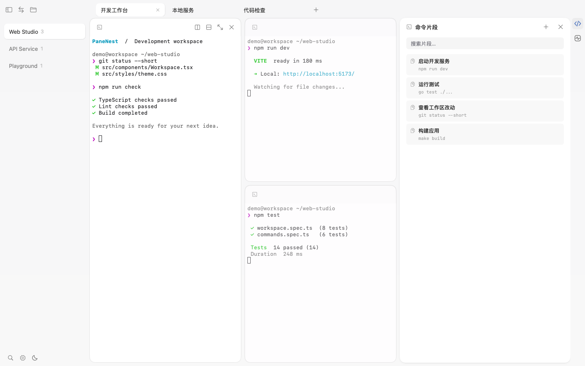

## PaneNest

> **二次开发说明：PaneNest 基于开源项目 [Kero（egoist/kero）](https://github.com/egoist/kero) 二次开发并独立维护。**
>
> 基于原项目 v2.1.27（`4ebd0de`），沿用 MIT 许可证并保留原始版权声明，详见 [LICENSE](LICENSE)。

面向个人长期使用的终端与编程代理工作台。每个项目可以保存多个会话、分屏窗格和浏览器页面；后台服务负责保留会话。



## 相较 Kero 的更新

PaneNest 保留 Kero 的终端、编程代理集成、浏览器窗格和后台会话能力，在 v2.1.27 的基础上主要做了以下调整：

- **项目与会话布局**：左侧集中展示项目，顶部以标签切换项目内的会话；支持项目、会话标签拖拽排序，以及标签重命名、中键关闭和溢出滚动。
- **独立的 SSH 工作区**：新增 SSH 连接列表和连接管理，本地终端与 SSH 视图分别记住选择状态，每个 SSH 连接保留自己的终端标签。
- **命令片段面板**：保存、搜索、编辑和复制常用命令；点击片段填入当前终端，确认后再手动执行。
- **本机系统状态**：新增 CPU、内存、交换空间的用量面板，以及 CPU 用量趋势，打开面板时定期采样。

这些是 PaneNest 的二次开发改动；终端会话持久化、分屏、编程代理集成等基础能力来自 Kero。

## 开发

需要 Go 1.27.3。启用 `GOTOOLCHAIN=auto` 时，现有 Go 会自动获取所需工具链。macOS 本地构建使用 Xcode 工具。

```sh
make dev
```

开发应用显示为 **PaneNest Dev**。修改 Go 代码、翻译或资源后会自动重新编译、重启。桌面 UI 使用 Go / MyGo，`docs/` 保留上游使用文档。

```sh
make check
make build
```

Apple 芯片 Mac 的构建结果是 `build/darwin-arm64/PaneNest.app`。构建默认使用本地签名，适合本机使用。开发版构建位于 `.mygo/dev/`。

## 使用

将构建的 `PaneNest.app` 放入「应用程序」，然后打开。按 `⌘O` 添加项目，选择 **PaneNest → Install Command Line Tool…** 安装命令行。

```sh
panenest new -n dev-server -d /path/to/project -- npm run dev
panenest ls
panenest config path
```

### macOS 首次打开被拦截

当前构建使用本地签名，尚未经过 Apple 公证。首次打开时，macOS 可能提示「未打开 PaneNest.app」或「Apple 无法验证 PaneNest.app 是否包含可能危害 Mac 安全或泄漏隐私的恶意软件」。这表示 Apple 无法验证应用，不代表已经检测到恶意软件。

如果应用由你自己构建，或已确认下载来源可信，可以按以下步骤放行：

1. 关闭提示窗口，打开 **系统设置 → 隐私与安全性**。
2. 找到 PaneNest 被阻止的提示，点击 **仍要打开**。
3. 按提示验证身份并确认打开，之后通常可以正常启动。

如果没有对应按钮，也可以在终端中移除该可信应用的下载隔离标记，然后重新打开：

```sh
xattr -dr com.apple.quarantine "/Applications/PaneNest.app"
```

如果应用不在「应用程序」目录，请将命令中的路径替换为实际路径。此操作仅移除指定应用的隔离标记，不会为应用添加 Apple 公证。

若要让分发版本通过 macOS 的常规验证，发布流程需要使用 Developer ID 签名、提交 Apple 公证并装订公证票据；本地签名不能替代这些步骤。详见 [Apple：在 Mac 上安全地打开 App](https://support.apple.com/zh-cn/102445)。

## 更新与上游同步

更新 `mygo.json` 的版本号并推送到 `main` 后，GitHub Actions 会自动构建 macOS、Windows、Linux 的 x64 和 ARM64 安装包并发布 Release；也可通过 `make build` 构建本机应用。

设置中的「检查更新」读取 PaneNest 仓库的最新正式 Release，显示新版本和发布说明，并通过「前往下载」在浏览器中打开下载页面。此功能需要公开可访问的 Releases，目前不自动下载或安装。桌面与服务端的自动安装更新源、公钥仍未配置。发布流程和更新配置见 [RELEASING.md](RELEASING.md)。

同步上游时，应先审阅差异，再选择性合并。应用名称、数据目录、环境变量、服务标识和更新配置由 PaneNest 独立维护。

`docs/` 和历史 `CHANGELOG.md` 保留上游资料，其中的产品名和安装命令对应原始项目。
